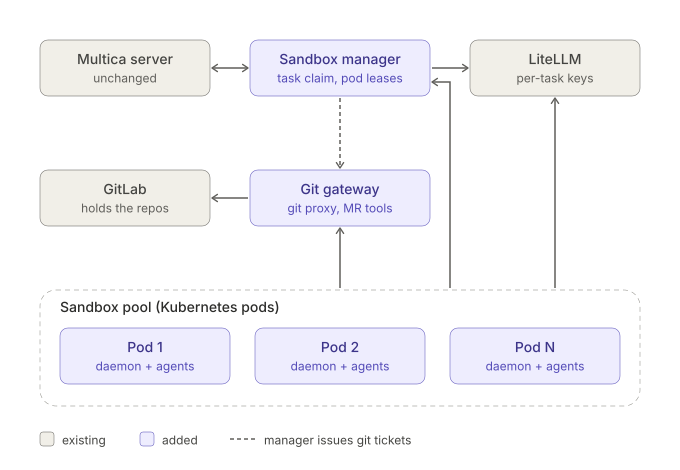
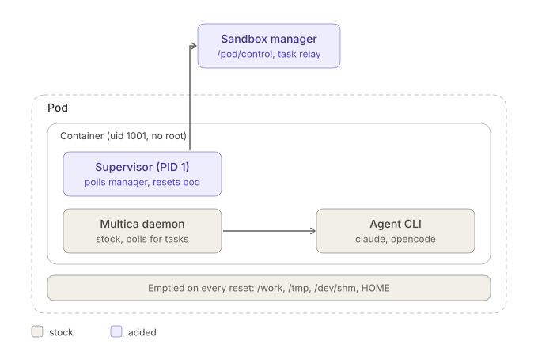

# Pool manager configuration

`sandbox-manager` runs as the pool manager when `SANDBOX_POOL_TOKEN` (or
`SANDBOX_POOL_TOKEN_FILE`) is set. The manager is a normal Multica account's
local daemon: it serves every workspace that account belongs to, finds new ones
by itself, and needs no workspace list (SIGHUP looks again at once). The settings are read once at startup; a bad
value stops the process with a message naming the variable. Durations use Go
syntax (`45s`, `10m`, `2h`). Unset or `0` means the default shown.

Secrets accept `NAME` or `NAME_FILE` (a path; surrounding whitespace is
trimmed). Setting both is refused. Secret values are never logged or echoed in
errors. Prefer the `_FILE` form with a mounted secret.

## Architecture





## Core

| Variable | Default | Meaning |
| --- | --- | --- |
| `SANDBOX_POOL_TOKEN` | none | PAT of the account the manager runs as (secret; `_FILE` form accepted). Selects pool mode. Use a dedicated account that is a member of every workspace to serve. It is the only Multica credential: every workspace is served with it (see [Known limits](#known-limits-and-operations)). |
| `SANDBOX_POOL_MAX_LEASES` | `0` | Concurrent leases allowed in each workspace; 0 is no cap. |
| `SANDBOX_POOL_SYNC_INTERVAL` | `30s` | How often the account's workspaces are listed again. A workspace joined is served from the next pass; one left out of two listings in a row drains like a removed one (`SANDBOX_POOL_DRAIN_TIMEOUT`), and one that comes back while draining is served again with its leases intact. A failed or empty listing changes nothing. Each pass also retries sharing runtimes whose visibility change failed, and re-sends pods the workspaces-changed hint (at most every 30s) while a workspace has no upstream registration. |
| `SANDBOX_POOL_RECONCILE_INTERVAL` | `30s` | Lease reconciliation period; `0` turns it off (and with it the retry of failure reports). See [Lease end and reconciliation](#lease-end-and-reconciliation). |
| `SANDBOX_POOL_LEASE_MAX` | `SANDBOX_LITELLM_TASK_TIMEOUT` with LiteLLM, else `2h` | Longest a lease may last. A task still leased after it is failed upstream ("task exceeded the maximum lease time") and its pod reset. |
| `SANDBOX_POOL_RUNTIME_VISIBILITY` | `public` | Visibility set on the runtime registered in each workspace. A runtime starts private to its owner, so `public` is what lets every member bind agents to it; `private` leaves sharing to the owner. |
| `MULTICA_SERVER_URL` | none | Multica server base URL. |
| `SANDBOX_MANAGER_LISTEN` | `:8790` | Pod API listener. Also serves `/healthz` (liveness: always 200) and `/readyz` (200 only if a workspace listing succeeded within three sync intervals, else 503). |
| `SANDBOX_POOL_ADMIN_LISTEN` | `127.0.0.1:8791` | Admin listener (inventory, leases, git verify). |
| `SANDBOX_MANAGER_NAME` | `Managed Sandbox` | Machine and default runtime name. |
| `SANDBOX_POOL_SIZE` | 0 | Declared pod count, shown next to live counts. |
| `SANDBOX_PROVIDERS` | all | Comma list of agent CLIs exposed as runtimes. Set it to the image's CLIs: a pod can otherwise add runtimes of any type. |
| `SANDBOX_POOL_DRAIN_TIMEOUT` | `10m` | How long a removed workspace keeps its leases. |
| `SANDBOX_POOL_HEARTBEAT_TIMEOUT` | `45s` | Silence after which a pod is listed lost. |
| `SANDBOX_POOL_RESET_TIMEOUT` | `2m` | Longest a pod may stay resetting. |
| `SANDBOX_POOL_LOST_RETENTION` | `10m` | How long a lost pod stays in the inventory before it is pruned (counted in `pruned_total`); a pod registering from a pruned IP is first-seen and reset. |
| `SANDBOX_POOL_GATEWAY_LISTEN` | off | Listener that serves only the git gateway's two verify endpoints (needs `SANDBOX_GIT_GATEWAY_URL`). |

## How a pod is reset and rejoins

The stock daemon sends no boot nonce and no `pod_ip`, so the manager needs
nothing from it to tell a reset has finished:

1. A reset starts when a lease ends (and for idle timeout, maximum lifetime, or
   a waiting task). The pod is `resetting` and the supervisor, polling
   `/pod/control`, is told to reset.
2. The supervisor has the agent runner close (kills the agents, empties the
   agent's HOME), kills every process in its own container, empties the shared
   writable areas and the daemon's HOME, rebuilds both HOMEs from their
   templates, **starts the new daemon, then reports `done`**. The report
   is the acknowledgement.
3. The next registration from that IP after the acknowledgement is the new
   daemon's. It completes the reset and the pod is `idle`. A registration that
   arrives before the supervisor has even fetched the reset command is the old
   daemon's and changes nothing. One that arrives after the supervisor fetched
   the command but before its report is the new daemon's (the supervisor stops
   the old daemon first and starts the new one before it reports): it is kept,
   and the report completes the reset with it.

If the reset itself fails, the supervisor tries it twice more (pausing 1s, then
2s), then reports `failed` and exits non-zero, so the kubelet restarts the
container; the restarted supervisor empties the writable areas before it starts
the daemon. The manager lists the pod `lost`, and its next registration resets
it once more before it is lent. A supervisor whose control URL keeps answering
404 (the manager does not know the pod: its daemon cannot register, or the
manager pruned it) for 5 minutes exits the same way.

The supervisor also reports two events on `/pod/control`: `started` when it
(so the container) starts, before the daemon, and `daemon-exited` when the
daemon exits by itself, before the daemon is started again. Either one on a pod
that holds tasks ends them: the tasks are failed upstream ("the pod's daemon
restarted"), their leases end with "pod daemon restarted" or "pod container
restarted" (LiteLLM key and git token revoked), and the pod is reset. Without
this the stock daemon, which sends no boot nonce, would register again within
the heartbeat timeout as the same instance and inherit leases whose tasks died
with the old process.

The reset also empties `/dev/shm` when the supervisor is given it (`POD_SHM_DIR`;
`pool/k8s/pool.yaml` mounts a memory-backed emptyDir there in both containers
and sets it).

The manager answers a heartbeat from a pod it does not know (or has marked lost)
with `404 runtime not found`, which is what makes the stock daemon register again;
this is how the pool rebuilds itself after a manager restart. The same answer
goes to a pod heartbeating a runtime that Multica reported gone (its upstream
heartbeat got `404 runtime not found`: deleted in the UI, or collected after a
long time offline): the manager drops that workspace's registration, and the
pod's registration that follows registers the workspace upstream again.
Orphan recovery (`recover-orphans`, and revoking LiteLLM keys left by an
earlier manager) runs only for a workspace that holds no lease or claimed task
in the manager.

A pod the manager has never seen is treated the same way: its registry entry
is created `resetting`, and it is reset before it is lent. After a manager
restart every pod, a busy one included, goes through this once, because the
registry is in memory.

A pod that is lost while it holds leases has those leases ended (task failed
upstream, LiteLLM key and git token revoked, release audited). If it
registers again it is reset first.

`boot_nonce` and `pod_ip` in the registration are optional extras for daemons
that send them (a different nonce on a known IP is a new instance and replaces
the old state at once). **The stock daemon sends neither**, so with it the
nonce check never fires (the supervisor events above take its place) and the
registration-time IP consistency check the spec describes does not run at all.
Without `pod_ip` the manager cannot detect a rewritten source address (SNAT, a
mesh): that check is then the manual step of the cluster smoke test
(`pool/k8s/README.md`, ticket 20), which compares the pod IPs in
`/v1/inventory` with `kubectl get pod -o wide`.

## Pod API authorization

Pods are identified by source IP only. On top of the endpoint allowlist:

- The workspace list (`/api/workspaces`, `/api/daemon/workspaces`) is served
  only to a registered pod, or to an address whose supervisor used
  `/pod/control` in the last 10 minutes (the supervisor announces itself before
  it starts the daemon, whose first call is that list). Anything else gets 403.
- A workspace's repos and settings (`/api/daemon/workspaces/{id}/repos`), which
  the manager reads with its PAT, are served only to a pod that holds a task of
  that workspace (leased or queued on it), or to a pod that runs no task and
  registered for the workspace (idle, or the new daemon of a reset about to
  complete). A pod working for another workspace gets 403; the daemon's
  settings refresh for its other workspaces then fails quietly.

## Lease end and reconciliation

A lease ends, its LiteLLM key and git token are revoked and the pod is reset
(a shared pod: once its last task ends) in these cases; `end_reason` in
`/v1/leases` says which:

| Cause | `end_reason` | Task failed upstream? |
| --- | --- | --- |
| The pod reports `complete`, `fail` or `cancel-ack` and Multica takes it | `pod reported <action>` | no (the pod reported it) |
| Multica refuses that report with 401, 403 or 404 | `upstream refused the pod's <action> report (HTTP <code>)` | no (Multica no longer knows the task) |
| Reconciliation finds the task completed, failed or cancelled | `upstream task ended: <status>` | no |
| Reconciliation gets 404 for the task | `upstream task ended: not found` | no |
| Reconciliation gets 401 or 403 | `upstream access lost (HTTP <code>)` | no (it cannot be) |
| The lease is older than `SANDBOX_POOL_LEASE_MAX` | `lease exceeded the maximum lease time` | yes: "task exceeded the maximum lease time" |
| The pod's daemon or container restarted (supervisor event) | `pod daemon restarted` / `pod container restarted` | yes: "the pod's daemon restarted" |
| The pod was lost, replaced, past its lifetime, or its workspace drained | as before | yes |

Reconciliation runs every `SANDBOX_POOL_RECONCILE_INTERVAL`: it asks Multica
for each leased task's status with the endpoint the stock daemon polls
(`GET /api/daemon/tasks/{id}/status`, with the PAT), at most 8 calls at once
and 10s each, never holding the registry lock while it waits. Any other error
keeps the lease for the next pass.

A failure report that does not reach Multica (network error, timeout, 429 or
5xx) is queued and sent again by every reconciliation pass until Multica takes
it, refuses it with another 4xx (taken as already handled), or 30 minutes have
passed. `/v1/inventory` shows the queue length as `pending_fail_reports`.

## Inventory and readiness

`/v1/inventory` also reports `last_sync` (`ok`, `at`, `error` of the latest
workspace listing), `oldest_lease_age_seconds` (a value near the maximum lease
time points at a task nobody reports on), `pending_fail_reports`, and for each
workspace `upstream` (`ok`, `op`, `at`, `error` of its latest claim or
heartbeat to Multica). The workspace-reloaded log line is INFO only when a
listing changed something.

`/readyz` turns 503 when no listing succeeded for three sync intervals: a
revoked or expired PAT, or Multica unreachable. `pool/k8s/manager.yaml` points
the readiness probe at it, and its Services set `publishNotReadyAddresses`, so
a not-ready manager is visible (`kubectl get pods`, alerts) while pods keep
reaching it; cutting them off would stop their heartbeats and end every lease.

If the manager itself stalls longer than the heartbeat timeout (CPU
throttling, a paused process), the pods get one grace period instead of all
being marked lost at once.

Reset events are audited (`action: reset`): start, completion, timeout and
failure, with the task whose end caused it when there was one. `/v1/leases`
and the pods in `/v1/inventory` name the initiators.

## Placement and pod lifetime

| Variable | Default | Meaning |
| --- | --- | --- |
| `SANDBOX_PLACEMENT` | `task` | `task`, `issue` or `chat`: which tasks share a pod. Shared pods hold one person's tasks only. |
| `SANDBOX_POD_CONCURRENCY` | 1 (`task`), 20 otherwise | Tasks a shared pod runs at once. |
| `SANDBOX_PLACEMENT_WAIT` | `30s` | How long a claimed task waits for a pod. |
| `SANDBOX_POOL_WAKE_INTERVAL` | `1s` | Active dispatch tick; `0` leaves dispatch to the pods' polling. |
| `SANDBOX_POD_IDLE_TIMEOUT` | `15m` | Release a shared pod with no task for this long. |
| `SANDBOX_POD_MAX_LIFETIME` | `2h` | Stop giving a shared pod new tasks after this. |
| `SANDBOX_POD_DRAIN_GRACE` | `10m` | Time running tasks get after max lifetime. |

## Task dispatch

The stock daemon in a pod polls for a task every 30 seconds, so a task would
wait that long for an idle pod. The manager therefore dispatches itself: the
daemon opens its usual wake websocket on the manager, and every
`SANDBOX_POOL_WAKE_INTERVAL` the manager claims one task upstream for a free
pod that holds a socket, places it as a poll would, and sends the target pod
the hint that makes it claim at once. The socket carries hints only: claims,
heartbeats and results stay on HTTP, and the pod's polling remains the
fallback and the liveness signal, so a pod without a socket or a lost hint is
served by its next poll. Neither Multica nor the pod image changes.

## Audit

| Variable | Default | Meaning |
| --- | --- | --- |
| `SANDBOX_AUDIT_FILE` | off | JSON Lines audit log, appended (0600). `-` writes to stdout. |

## LiteLLM (per-task keys)

Enabled by `SANDBOX_LITELLM_URL`; any other `SANDBOX_LITELLM_*` variable
without it is an error.

| Variable | Default | Meaning |
| --- | --- | --- |
| `SANDBOX_LITELLM_URL` | off | LiteLLM base URL the manager calls. |
| `SANDBOX_LITELLM_POD_URL` | the URL | Base URL given to agents, if pods reach LiteLLM differently. |
| `SANDBOX_LITELLM_MASTER_KEY` / `_FILE` | required | Admin key; stays in the manager. |
| `SANDBOX_LITELLM_MODELS` | required | Comma list of models a task key may call. |
| `SANDBOX_LITELLM_MAX_BUDGET` | required, above 0 | Budget per task key. |
| `SANDBOX_LITELLM_RPM_LIMIT` | required, above 0 | Requests per minute per task key. |
| `SANDBOX_LITELLM_TASK_TIMEOUT` | `2h` | Longest task; key expires after this plus margin. Also the default `SANDBOX_POOL_LEASE_MAX`, so the lease (and the task) ends before the key does. |
| `SANDBOX_LITELLM_MARGIN` | `15m` | Slack after the task timeout. |
| `SANDBOX_LITELLM_ENV` | Anthropic/OpenAI base URL and key | `NAME=VALUE,...` forced into the agent env. `${LITELLM_URL}` and `${LITELLM_KEY}` are replaced. Names must not start with `MULTICA_`. |

The budget and rate caps are mandatory when LiteLLM is on: the manager refuses
to start without both (`SANDBOX_LITELLM_MAX_BUDGET` and
`SANDBOX_LITELLM_RPM_LIMIT` above zero). A key without its own caps would be
limited only by the initiator's personal budget, and a leaked key could spend
all of it at any rate. LiteLLM's error text is stripped of the master key and
the task key before it reaches logs, the audit trail or a task's failure
message.

## Git gateway

Enabled by `SANDBOX_GIT_GATEWAY_URL`, the gateway address as pods reach it.

| Variable | Default | Meaning |
| --- | --- | --- |
| `SANDBOX_GIT_GATEWAY_URL` | off | Gateway base URL for pods. |
| `SANDBOX_GIT_GATEWAY_ENV` | `GIT_GATEWAY_TOKEN=${GIT_TOKEN}` | `NAME=VALUE,...` forced into the agent env. `${GIT_TOKEN}` and `${GIT_GATEWAY_URL}` are replaced. Names must not start with `MULTICA_`. |
| `SANDBOX_GIT_GATEWAY_MCP_URL` | off | The gateway's MCP endpoint as agents reach it, always `<SANDBOX_GIT_GATEWAY_URL>/mcp` (for example `http://git-gateway:8081/mcp`). Each task then gets a `gitlab-gateway` MCP server carrying its token. Must be http(s); only valid with `SANDBOX_GIT_GATEWAY_URL`. |

The gateway (`cmd/git-gateway`) is a separate process, but the token registry
lives in the manager. The manager serves the gateway's verification endpoints
on the **admin** listener (loopback by default) and, when
`SANDBOX_POOL_GATEWAY_LISTEN` is set, on a listener of their own that carries
nothing else. Prefer the latter whenever the gateway runs in another pod, so
run the gateway with:

```
GIT_GATEWAY_VERIFY_URL=http://<manager>:8792/v1/git/verify-token
GIT_GATEWAY_POD_VERIFY_URL=http://<manager>:8792/v1/git/verify-pod
```

Agents push with the task token: the pool image's system gitconfig has a
credential helper (`git-credential-gateway`) that answers `agent` /
`$GIT_GATEWAY_TOKEN` for the gateway's origin only. The image's
`GIT_GATEWAY_URL` build argument is the gateway root, with no path prefix.

The gateway serves git at `/` and its MCP tools at `/mcp` on the same
`GIT_GATEWAY_LISTEN` listener, so the MCP URL is the gateway URL plus `/mcp`.

Gateway policy (all optional; invalid values stop the gateway at startup with
an error that names the variable):

| Variable | Default | Meaning |
| --- | --- | --- |
| `GIT_GATEWAY_BRANCH_PREFIX` | `agent/` | A task may push only `refs/heads/<prefix><task id>/*`. |
| `GIT_GATEWAY_MIN_READ_LEVEL` | `20` | Lowest GitLab access level that may clone: 10, 20, 30, 40, 50 or guest, reporter, developer, maintainer, owner. |
| `GIT_GATEWAY_MIN_PUSH_LEVEL` | `30` | Lowest access level that may push or open a merge request; not below the read level. |
| `GIT_GATEWAY_MR_TARGETS` | project default branch | Comma list of branches a merge request may target. |
| `GIT_GATEWAY_MR_LABEL` | `created-by-agent` | Label on every merge request the gateway opens. |
| `GIT_GATEWAY_TASK_URL` | none | http(s) link template for the merge request description; `{task_id}` and `{workspace_id}` are replaced. |

The verify endpoints are unauthenticated: keep the gateway listener (or, if you
move the admin listener off loopback instead, that one) unreachable from pods
with network policy. The gateway keeps its record of pushed branches in
memory, so run one replica; the record is dropped when the task ends only if
the gateway shares the manager's token registry, and otherwise ages out
(`PushLogTTL`, 24 hours) or is capped at 10000 tasks.

## Daemon and agent containers

A pool pod has two containers of one image. Nothing in the pod runs as root:
no process, no capability (all dropped, `no-new-privileges`), no setuid
binary used. The cluster needs no Kubernetes API for the pod and the image
needs no root at run time.

| | `daemon` container | `agent-runner` container |
|---|---|---|
| User | `sandboxd`, uid 1001 | `node`, uid 1000 |
| PID 1 | `pod-supervisor` (polls the manager, runs the daemon) | `pod-supervisor -role runner` (starts agent CLIs) |
| Own volume | `/home/daemon` (the daemon's `HOME`, with its `tmp`) | `/home/agent` (the agent's `HOME`) |
| Shared volumes | `/work`, `/tmp`, `/dev/shm` | the same |
| Processes visible | its own | its own |

Both run as group 2000 and the pod's `fsGroup` is 2000, so files in the shared
volumes are group 2000 and the group can use them (umask 007, set by both PID
1s). The two users have no other file in common.

The stock daemon starts each agent as its own user and cannot be told
otherwise, so the split is done around it:

- The daemon's `PATH` starts with `/usr/local/libexec/pod-agents`, which holds
  a hard link of `pod-supervisor` named like each installed agent CLI
  (`AGENT_COMMANDS` build argument, default `claude`). The daemon finds and
  runs that "CLI". Run under an agent's name the binary is a shim: it sends its
  arguments, working directory, environment and stdin/stdout/stderr
  (`SCM_RIGHTS`) to the runner over an abstract unix socket (a pod has one
  network namespace, so both containers see it), and the runner runs the real
  CLI, found on the `PATH` without the shim directory, in the agent container in
  its own process group. The shim relays signals and exits with the agent's
  status. If the shim dies (the daemon kills its process group) the agent and
  its process tree are killed.
- A file that the daemon names in an agent's arguments and keeps in its private
  `TMPDIR` (the task's MCP configuration) is read by the shim and written by the
  runner as a copy in the shared `/tmp`, and the argument is rewritten to the
  copy; the copy is removed when the agent ends.
- The runner answers only a peer with uid 1001 (`SO_PEERCRED`), on both its
  sockets: the launch socket and the control socket the supervisor uses
  (`close`, `open`, `status`). The agent, uid 1000, is turned away. The names
  are fixed in the image (`POD_AGENT_SOCKET`), so the check, not secrecy of the
  name, is the protection.
- A reset is the supervisor's: it stops the daemon, has the runner **close**
  (refuse launches, kill every process in the agent container, empty its `HOME`
  and what it can of the shared volumes, restore the `HOME` template), kills the
  daemon's remaining processes, empties the shared volumes and the daemon's
  `HOME`, restores the daemon's template, starts the daemon and has the runner
  **open**. A runner that restarted on its own comes back closed and the
  supervisor opens it again within five seconds while the daemon runs. If the
  runner cannot be reached the reset fails and is retried like any failed
  reset; at start the supervisor waits up to two minutes for the runner, then
  exits so the kubelet restarts the container.
- `git` trusts both users (`safe.directory *`, `core.sharedRepository group`).
  Before launching, the shim opens the files the daemon created in the task
  directory to the shared group.

What the agent cannot do: see the daemon's processes (separate process
namespaces: no `/proc/<daemon>`, no signals, no `ptrace`), read the daemon's
`HOME` or config (a volume the agent container does not have), or use the
runner (uid check). Checked against the cluster by the pool e2e scenarios.

### Residual risks

The split is not a full isolation of the daemon, because the daemon is unchanged:

1. **The daemon runs code that the agent can influence.** The daemon and the
   agent share the task files and the bare repository cache (`.repos`), which
   the agent must be able to write for commits to work. The daemon runs `git`
   there as uid 1001. An agent can plant a repository config (`core.fsmonitor`,
   a filter driver, an alias, `core.sshCommand`) or a hook there and have it
   executed as the daemon the next time the daemon runs git in that repository,
   for example in `multica repo checkout`. That gives the agent uid 1001 inside
   the daemon container: the daemon's `HOME` and process, the supervisor
   (same user), and with it the runner's control socket, so it can close the
   runner and kill its own pod's agents. What it reaches is the placeholder
   token and the manager address, neither of which is a secret (anything in the
   pod can already call the manager from the pod's IP). It has no root and no
   capability, and does not reach any credential of the manager, LiteLLM or
   GitLab. A fix needs the daemon to run git as the agent user or to keep the
   cache out of the agent's reach, i.e. a daemon change.
2. **Daemon network surface.** The containers share the pod's network
   namespace, so the agent can reach the daemon's local HTTP listener (the
   `multica repo checkout` endpoint, authorised by the task token) and the
   manager. The manager already treats the pod's IP, not a secret, as the
   identity. Any process in the pod can also open an abstract socket, but the
   runner's two are bound first and uid-checked.
3. **Files created later by the daemon.** Files that the daemon creates itself
   (not through `git`) in a task directory after the agent was started follow
   umask 007, so they are group 2000 and usable by the agent; ones whose mode
   the daemon sets explicitly (0755, 0644) are not writable by the agent.
   Directories and files created before launch are opened to the group by the
   shim.
4. **Workspace-level boundary.** All task directories in a shared pod are
   readable by both users (decision B in the spec); the split does not
   separate tasks from each other.
5. **Agent CLIs not shimmed.** Only the names in `AGENT_COMMANDS` run in the
   agent container. Anything else the daemon starts by itself (its own `git`,
   helper processes) runs in the daemon container as uid 1001, and an agent CLI
   that is missing from `AGENT_COMMANDS` but installed would run there. Keep
   the list equal to the installed CLIs.
6. **Same-user processes.** Processes of one task can still signal and ptrace
   each other and those of other tasks in a shared pod, as before.
7. **Shared volumes are group-writable.** Both users can delete each other's
   files in `/work`, `/tmp` and `/dev/shm` (no sticky bit: the volumes belong
   to the kubelet). The daemon's private files are in `/home/daemon`, not there.

## Single container (prototype)

`pool/k8s/pool-single.yaml` and `pool/compose/pool-single.yaml` run a pod as
**one container, one user** (uid 1001, group 2000): `pod-supervisor --single`
is PID 1 and runs the daemon, which starts the agent CLIs itself. There is no
runner, no shim directory, no abstract sockets, no second volume set, and on
Docker no pause container and no generator: the Compose pool is one service
sized with `--scale pod=N`. The image is the same; `POD_ROLE=single` selects
this mode (`POD_ROLE` unset or `runner` is the two-container pod). A pod
cannot get two users without `CAP_SETUID` and `CAP_KILL`, which the pod must
not have, so this is the layout without the split.

The one requirement it is built for is **nothing leaks from one task to the
next**. It holds because:

1. **A reset leaves nothing.** The supervisor stops the daemon, SIGKILLs every
   process of the pod (everything descends from PID 1; it repeats until none is
   left, so a fork storm or a respawning shell cannot win the race), and only
   then empties `/work`, `/tmp`, `/dev/shm` and `HOME` (read-only and
   mode-000 directories, links, FIFOs and trees deeper than `PATH_MAX`
   included, all through `os.Root`) and restores `HOME` from the template. A
   reset that keeps failing exits the supervisor, so the kubelet restarts the
   container, whose start empties the same areas.
2. **The agent cannot disable the reset.** The agent has the supervisor's
   user, so the supervisor protects itself: it sets `PR_SET_DUMPABLE` to 0
   (the same user can neither `ptrace` it nor read `/proc/1/mem`, `environ`,
   `maps` or `fd`; the flag does not survive `execve`, so the daemon and the
   agents are ordinary processes); as PID 1 it is immune to `SIGKILL` and
   `SIGSTOP` sent from inside the pod (the kernel drops them), and it ignores
   `SIGHUP`, `SIGQUIT`, `SIGABRT`, `SIGUSR1/2` and the other signals that would
   end a Go program. The root filesystem is read-only and the supervisor binary
   is not writable. `kill(-1, SIGKILL)` by the agent kills the daemon and every
   agent but not PID 1; the pod is reset like after a daemon crash.
3. **The daemon holds no credential that outlives a task.** Its `HOME` config
   (`.multica/config.json`) carries the manager address and the placeholder
   token `pool-placeholder`: the manager identifies a pod by its source IP and
   ignores the bearer token (`Pool.PodHandler`), and relays an agent's
   `multica` CLI traffic only with a task token (`mat_`, `serveAgentAPI`).
   The LiteLLM key and the git gateway token are minted per task, injected
   into that task's environment, and revoked when the lease ends. The
   long-lived secrets (PAT, LiteLLM master key, GitLab token) live in the
   manager and the gateway, not in a pod (checked by `s_no_secrets`).

**What is weaker than the two-container pod, stated plainly:**

- The agent runs as the daemon's user and sees the daemon: it can read its
  process (`/proc/<daemon>/environ`, memory, arguments), its `HOME` and the
  config in it, and, on a host with `kernel.yama.ptrace_scope=0`, trace and
  inject into it. With Yama at 1 or higher (the default on many distributions,
  and the dev host of the end-to-end run) a non-descendant cannot be traced,
  but this is host configuration, not something the pod enforces. In the
  two-container pod the daemon is behind a user and a process-namespace
  boundary (although residual risk 1 above already hands the agent that
  user through the daemon's `git`). What the agent gets is the current task's
  own material, the placeholder token and the manager address; the daemon can
  also be made to misbehave **for the task it serves**, which cannot affect
  the next one because the reset kills it.
- The daemon's and the agent's files are not separated (`TMPDIR`, `HOME` and the
  task directories are one user's). The shared-pod placement limits above
  (`issue`, `chat`) still do not separate tasks inside one pod; use `task`
  placement.
- An agent can still end its own pod: `SIGTERM` or `SIGINT` to PID 1 stops the
  supervisor, the container restarts and empties the same areas at start (an
  availability cost for the running task, not a leak; the end-to-end run checks
  that nothing survives). A forged `POST` to the manager's control URL from the
  pod's address could report a reset "done" that did not run; this is
  unchanged from the two-container pod, which shares the network namespace.
- A kernel or runtime escape is as in any container; nothing here defends
  against it.

Sizing: one container takes the agent container's resources (the daemon's
share is small). The pod's memory limit also covers `/dev/shm` and any tmpfs.

Checked by `pool/e2e/single-pod-scenarios.sh` (hostile task: ptrace and signals
at PID 1, `kill(-1)`, `SIGTERM`, planted files and processes, and a follow-up
task on the same pool) and the Go tests in `server/internal/podsupervisor`
(`single_test.go`). See `pool/e2e/README.md` for what ran.

## Claude Code in the pod

Checked against Claude Code 2.1.314 with a fake Anthropic-style endpoint, the
daemon's argument list (`--strict-mcp-config --mcp-config <file>`, stream-json)
and an empty, even read-only, HOME:

- `ANTHROPIC_AUTH_TOKEN` + `ANTHROPIC_BASE_URL` (the `DefaultLiteLLMEnv`
  pair) are honoured: requests go to `<base>/v1/messages?beta=true` with
  `Authorization: Bearer <key>` and `anthropic-version: 2023-06-01`. No login
  or onboarding is needed. The model is the agent's `--model`, else Claude
  Code's own default (`claude-opus-5-5` for this version): the task key's
  `Models` must list it, and the small fast model
  (`ANTHROPIC_DEFAULT_HAIKU_MODEL`) if the deployment maps it elsewhere.
- The gateway's MCP entry (`type: http`, `headers.Authorization`) connects,
  lists and calls its tools; the Bearer header is sent on every POST.
- The image sets `CLAUDE_CODE_DISABLE_NONESSENTIAL_TRAFFIC=1` and
  `DISABLE_AUTOUPDATER=1`; without them Claude Code opens a connection to
  `api.anthropic.com` at start (telemetry). It is not fatal when blocked.
- Claude Code needs a writable HOME only to keep session state; it still runs
  with a read-only one, but `--resume` then has nothing to resume.
- If the LiteLLM models are not served by Anthropic's own API (Bedrock,
  Vertex, other vendors), add `ENABLE_TOOL_SEARCH=false` and
  `CLAUDE_CODE_DISABLE_EXPERIMENTAL_BETAS=1` to the agent's `custom_env` or
  `LiteLLMConfig.Env`: by default Claude Code sends the `advanced-tool-use`,
  `context-management` and other beta headers and defers MCP tools behind a
  `ToolSearch` tool, none of which such backends are guaranteed to accept.

## Known limits and operations

- **Restarting or upgrading the manager fails every running task.** The
  registry is in memory: after a restart every pod is reset and the tasks
  Multica still shows running on the pool's runtimes are failed (Multica retries
  those eligible). Upgrade when the pool is idle (`/v1/inventory` shows no
  `leased` pod), or accept the retries.
- **Accepting an invitation opens the pool to that workspace.** The manager
  serves every workspace its account belongs to, and its runtimes are `public`
  by default, so every member of a workspace the bot joins can bind agents to
  the pool within one sync interval. There is no allowlist and no fair-share
  floor: set `SANDBOX_POOL_MAX_LEASES` so one workspace cannot take the whole
  pool. A workspace that needs a pool of its own needs another bot account and
  another manager deployment.
- **One Multica and one LiteLLM per pool.** The upstream daemon ID is derived
  from the Multica URL and the workspace ID only, and orphaned LiteLLM keys are
  found by workspace only. Two managers (two pools, or staging and production)
  against the same Multica or LiteLLM register the same runtimes or revoke each
  other's keys. Multi-pool deployments are not supported.
- **Shared placement separates people, not tasks.** In `issue` and `chat`
  placement only tasks started by the same person share a pod (a task with no
  known initiator gets its own pod). Tasks of one person in one pod still share
  a user ID, a filesystem and an environment, so one agent can read another's
  git gateway token and LiteLLM key. Use `task` placement (the default) where
  tasks must stay apart.
- **`issue` and `chat` placement are experimental.** A pod bound to a key may
  claim a task of another key; with no idle pod left the task waits in the
  manager and is failed after `SANDBOX_PLACEMENT_WAIT` (30s: "no sandbox pod
  could take the task in time"), and while any task waits, no workspace claims
  anything.
- **Claim load and dispatch rate.** Active dispatch claims for one workspace at
  a time, one call per workspace per tick, even when nothing is queued: with
  many workspaces and an idle pod that is many claims per second to Multica.
  Each tick hands out at most one task, so filling many idle pods after a burst
  takes about one second per task (plus each pod's own 30s poll).
- **The PAT is a single point of failure.** It acts in every served workspace
  (its blast radius is everything that account can do in each of them, not just
  the pool), and when it is revoked or expires every workspace stops at once.
  The manager then keeps running: new tasks stay queued in Multica, reports of
  running tasks are refused and their leases end, `/readyz` turns 503, and
  `last_sync` and the workspaces' `upstream` show the error. To rotate it,
  create the new PAT, replace the Secret file, and restart the manager (which
  fails the running tasks, see above), then revoke the old PAT.
- **LiteLLM initiators must exist.** A task whose initiator has no LiteLLM user
  is refused (failed upstream); create the users before opening the pool to a
  workspace.
- **The CNI must enforce NetworkPolicy.** Pod identity is the source IP, and
  only the NetworkPolicies keep anything but pool pods away from the manager's
  pod port. Use a CNI that enforces them (Calico in the reference setup) and
  check that node-local traffic (hostNetwork pods, the node itself) cannot
  reach port 8080 of the manager.
## Agent CLIs in the image

The image carries Claude Code and opencode (1.19.5, the last 1.x release). Both
are listed in `AGENT_PACKAGES` and `AGENT_COMMANDS` of `Dockerfile.pool`; each
command gets a shim, so the daemon starts it in the agent container.

opencode reaches LiteLLM through the provider in
`deploy/sandbox/home/.config/opencode/opencode.json`, which reads
`OPENAI_BASE_URL` and `OPENAI_API_KEY` from the task's environment (the manager
sets them per task). Only that provider is enabled and it names only the models
LiteLLM serves, so the model picker of an opencode agent shows exactly those
(`litellm/<model>`). To offer another model, add it to the file and to
`SANDBOX_LITELLM_MODELS` of the manager.

Auto-update and the model catalog download are switched off
(`OPENCODE_DISABLE_AUTOUPDATE`, `OPENCODE_DISABLE_MODELS_FETCH`): the pods'
network policy allows neither.
